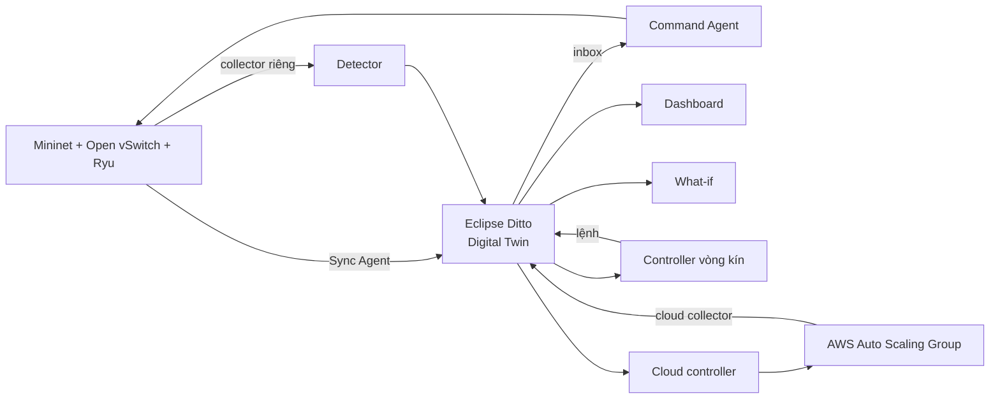

# DT4N: Digital Twin cho mạng máy tính trên Eclipse Ditto

Mã nguồn, dữ liệu và kết quả của đề tài nghiên cứu khoa học sinh viên
"Phát triển quản lý mạng thông minh: triển khai và tự động hóa bản sao số của mạng"
(Trường Đại học Công nghệ Thông tin, ĐHQG-HCM).

Hệ thống gồm một testbed Mininet đóng vai mạng thật, một Digital Twin trên Eclipse Ditto được
đồng bộ hai chiều với testbed, và các ứng dụng đọc hoặc điều khiển mạng qua twin: dashboard,
phát hiện bất thường (detector), mô hình what-if, tự động hóa tài nguyên AWS và một vòng điều
khiển kín trên testbed.



## Cấu trúc thư mục

| Thư mục | Nội dung |
|---|---|
| `ket-qua-bao-cao/` | kết quả chính thức, sắp theo từng mục của báo cáo, kèm lệnh chạy lại |
| `mininet/` | topology, Ryu (`controller_static.py`), tạo tải và sự cố, `run_sync.py`, `env_runner.py` |
| `bridge/` | Sync Agent, Command Agent, collector, detector chạy trực tiếp (`detector_runner.py`) |
| `ditto/` | cấu hình Ditto (Docker Compose), đặc tả topology, bảng định tuyến |
| `ml/` | dữ liệu, envelope, residual, FSM, cấu hình các đợt thu dữ liệu, học detector |
| `controller/` | controller vòng kín (định vị, chính sách, nhật ký) |
| `cloud/` | tự động hóa AWS: cloud collector, cloud controller, actuator, thí nghiệm |
| `whatif/` | mô hình what-if, kiểm hồi cứu và kiểm mù |
| `dashboard/` | giao diện Vue |
| `models/` | các bản detector; kết quả của báo cáo dùng `detector-release-2.1.0.json` |
| `data/` | dữ liệu thô (tập phát triển, tập nghiệm thu) |
| `results/` | tệp kết quả gốc mà các script ghi ra |
| `scripts/` | script thí nghiệm, chấm điểm và tái lập |
| `test/` | bộ kiểm thử (pytest) |
| `docs/` | tài liệu được các tệp tiêu chí ghim mã băm, giữ nguyên để kiểm toàn vẹn |
| `archive/` | mã, kết quả và ghi chép của các giai đoạn phát triển trước; không cần để tái lập báo cáo |

## Tải về và cài đặt

### 1. Tải mã nguồn và dữ liệu

```bash
git clone https://github.com/vantai13/dt4n-core.git
cd dt4n-core
```

Dữ liệu dùng cho kết quả của báo cáo là tệp Git thường, có ngay sau khi clone. Không cần
`git lfs pull`.

### 2. Môi trường phân tích (đủ để tái lập mọi kết quả offline)

Cần Python 3.11 trở lên.

```bash
python3 -m venv .venv
.venv/bin/pip install -r requirements-phase6r.lock.v2.txt
export PYTHONPATH="$PWD"
.venv/bin/python scripts/kiem_tra_moi_truong.py   # kiểm thư viện và dữ liệu
.venv/bin/python -m pytest -q                    # bộ kiểm thử, không cần Mininet
```

### 3. Testbed (chỉ cần khi muốn đo lại trên mạng giả lập)

Linux có quyền root và sudo không hỏi mật khẩu, Mininet 2.3, Open vSwitch, iperf v2, Ryu 4.34
(trong một môi trường Python riêng, ví dụ conda env `sdn_net`), Docker để chạy Eclipse Ditto
3.9.1. Cấu hình máy dùng cho kết quả của báo cáo ở Bảng 4.1 của báo cáo.

```bash
cp ditto/nginx.htpasswd.example ditto/nginx.htpasswd
(cd ditto && docker compose up -d)          # tài khoản demo ditto/ditto
export DT4N_RYU=/đường/dẫn/tới/ryu-manager  # nếu ryu-manager không nằm trong PATH
.venv/bin/python scripts/kiem_tra_moi_truong.py --testbed
```

Lệnh cuối kiểm sudo, Mininet, Open vSwitch, iperf, Ryu, Ditto, cổng 6653 và trần bộ nhớ của
MongoDB (cần ít nhất 1 GiB, `ditto/docker-compose.yml` đã đặt sẵn), mục nào thiếu thì in cách sửa.

### 4. AWS (chỉ cần cho Mục 5.6)

Tài khoản AWS có quyền EC2, Auto Scaling và Elastic Load Balancing, region `ap-southeast-1`,
môi trường Python có `boto3`. Thí nghiệm tạo máy t3.micro thật nên có phát sinh chi phí.

## Tái lập kết quả của báo cáo

Một lệnh tính lại mọi con số không cần testbed, rồi so khớp tuyệt đối với kết quả đã lưu:

```bash
.venv/bin/python scripts/tai_lap_bao_cao.py
```

```
3.4/5.3 Học lại detector 2.1 (K, E, biên, R, vùng vận hành)      KHỚP   K 18, E 5.6090, R 0.0753
5.3.1   Tập phát triển: excess, dual, Isolation Forest           KHỚP   excess 137/160, 23/430; ...
5.3.2a  Tập nghiệm thu: giảm băng thông, flood, dịch nút cổ chai KHỚP   S1 0.4, lớn nhất 20.0 s, R-C 4/4
5.3.2b  Tập nghiệm thu: tải cao và bộ chặn vùng tải              KHỚP   6 run, giây còn báo động khi áp bộ chặn: 0
5.3.2c  Tập nghiệm thu: chạy nền 2 giờ                           KHỚP   cận trên 1.50 lần/giờ trên 2.00 giờ
5.4     What-if: kiểm hồi cứu                                    KHỚP   trong vùng: trung vị 0.009, lớn nhất 0.10 Mbps
5.7     Vòng kín: kiểm offline luật chọn ứng viên                KHỚP   30 run
6.2.2   Cơ chế bỏ sót trên link s1-s2                            KHỚP   excess lớn nhất giây 21-39: 1.00

8 mục, 0 lệch hoặc lỗi.
```

Bản đồ đầy đủ "mục báo cáo → tệp kết quả → lệnh chạy lại", gồm cả các phép đo cần testbed hay
AWS, ở [ket-qua-bao-cao/README.md](ket-qua-bao-cao/README.md).

### Chạy lại thí nghiệm vòng kín trên testbed

```bash
scripts/chay_vong_kin.sh        # A/B rồi phép thử định vị, khoảng 2 giờ 10 phút; hoặc thêm "ab" hay "c1"
```

Script tự kiểm môi trường, dọn Mininet, bật Ryu riêng cho từng runner và ghi receipt vào
`logs/chay_lai_vong_kin/<thời điểm>/`, không đụng tệp kết quả trong `results/report/`.

### Yêu cầu khi chạy trên testbed

- `sudo mn -c` dừng luôn mọi tiến trình `ryu-manager`, và mỗi runner tự gọi bước dọn này khi
  kết thúc. Chạy hai runner liên tiếp thì phải bật lại Ryu ở giữa (`chay_vong_kin.sh` đã làm
  việc này). Ryu đọc `ditto/port_map.json` theo đường dẫn tương đối, nên phải bật Ryu từ gốc của
  chính repo đang chạy thí nghiệm.
- Các script tạo kết quả từ chối ghi đè tệp đã có trong `results/report/`. Muốn chạy lại thì
  dùng script chạy lại tương ứng (ghi ra thư mục mới), hoặc chuyển tệp cũ đi trước.
- Cấu hình thu dữ liệu (`--campaign gd4`, `gd4r`) chỉ chạy trên máy có tên `dt4n-research-01`
  và bỏ qua run đã có dữ liệu. Xem [README của thư mục kết quả](ket-qua-bao-cao/README.md#hai-lưu-ý-khi-chạy-lại).
- Không chạy thí nghiệm khi một Mininet hay Ryu khác (ví dụ bản demo) đang chạy trên cùng máy.

## Chạy hệ thống để xem demo

Mỗi lệnh chạy ở một terminal, từ gốc repo, với `PYTHONPATH="$PWD"`.

```bash
sudo mn -c                                                        # dọn Mininet trước khi bật Ryu
ryu-manager mininet.controller_static --ofp-tcp-listen-port 6653  # Ryu
sudo env PYTHONPATH="$PWD" /usr/bin/python3 -m mininet.run_sync --period 1   # testbed + Sync Agent + Command Agent
(cd dashboard && cp .env.example .env && npm ci && npm run dev)   # dashboard ở cổng 5173
python3 -m whatif.server                                          # trang what-if ở 127.0.0.1:8091
```

## Tài liệu khác

- Nguồn gốc mã: [PROVENANCE.md](PROVENANCE.md)
- Thư mục lưu trữ: [archive/README.md](archive/README.md)

## Giới hạn

Mọi kết quả đo trên một topology 3 switch chạy trên một máy, tải tối đa 5 Mbps mỗi máy khách
trong dữ liệu huấn luyện. Máy EC2 không mang lưu lượng của Mininet. Chi tiết ở Chương 6 của
báo cáo.
