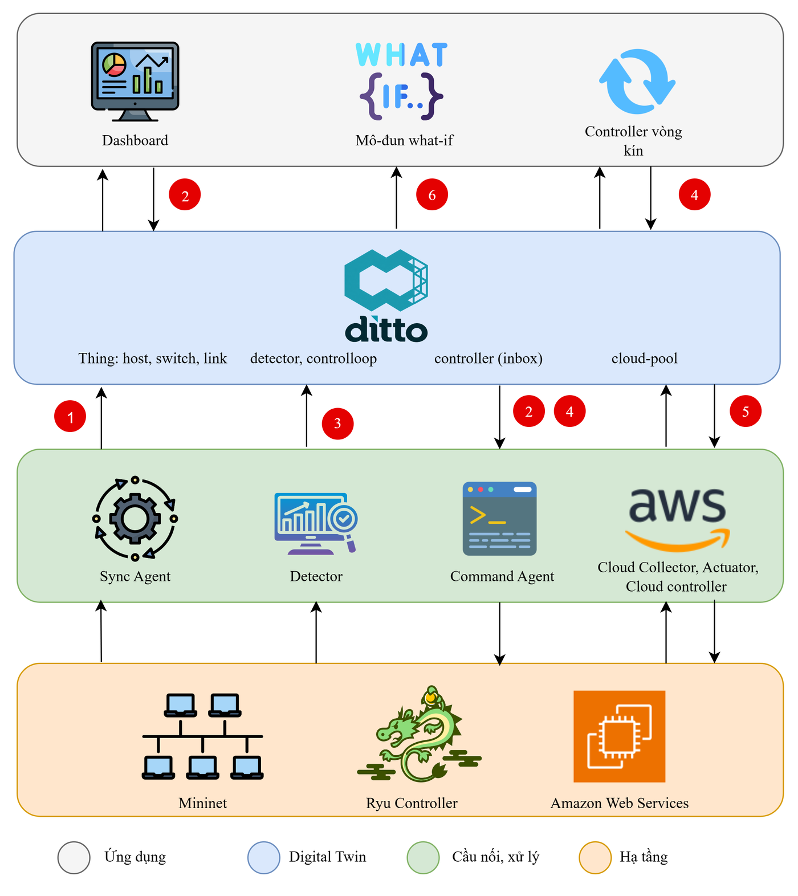
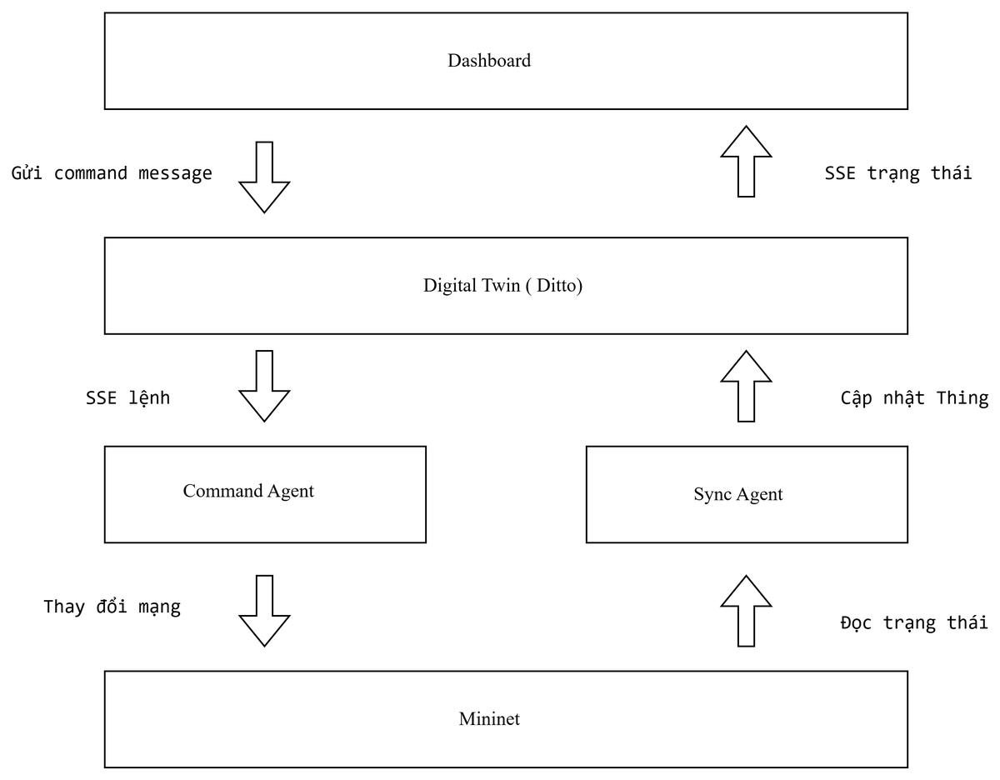
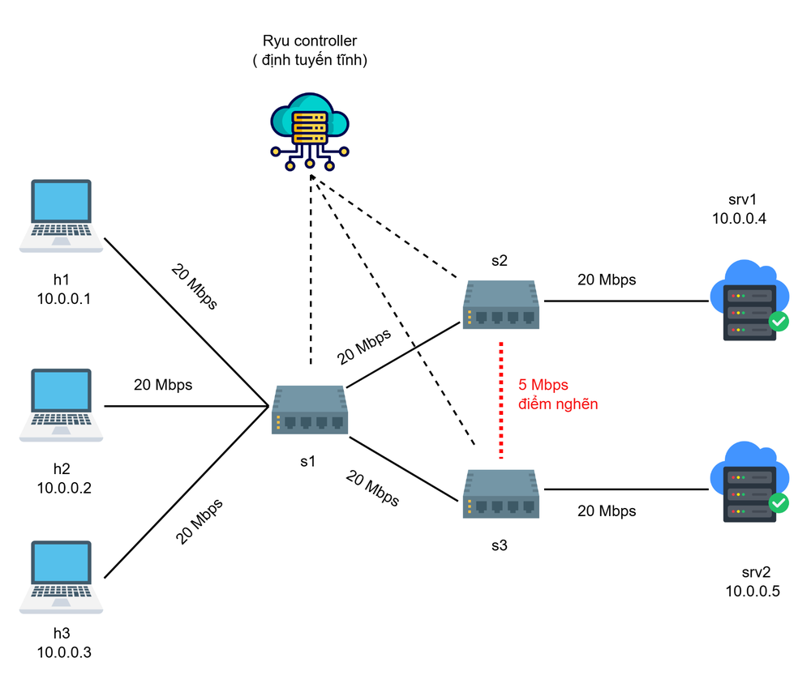
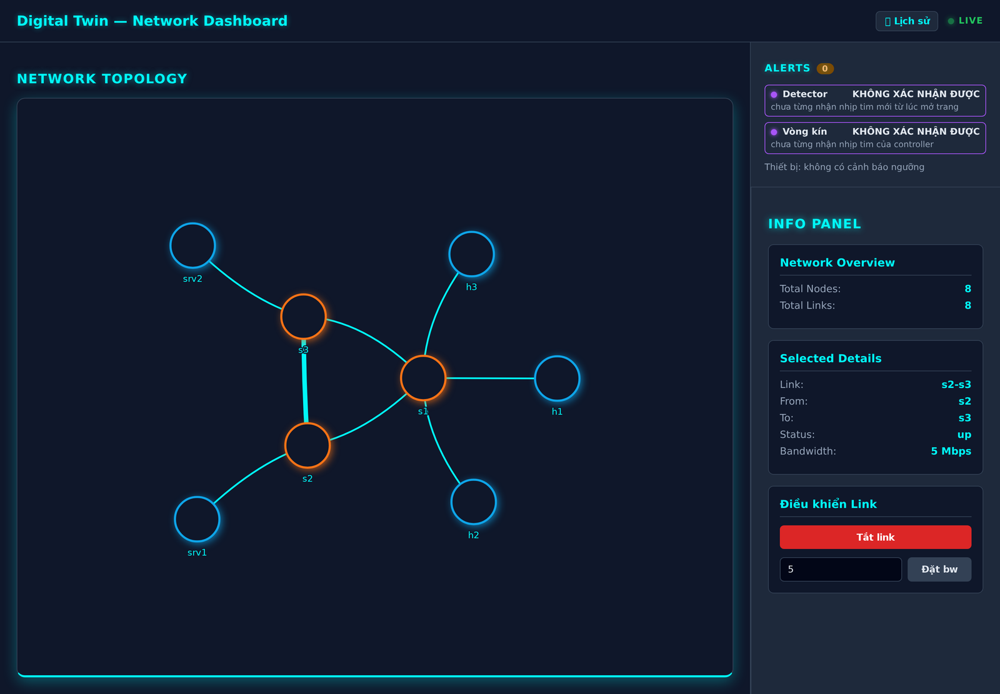

# DT4N: Digital Twin cho mạng máy tính trên Eclipse Ditto

Mã nguồn, dữ liệu và kết quả của đề tài nghiên cứu khoa học sinh viên
"Phát triển quản lý mạng thông minh: triển khai và tự động hóa bản sao số của mạng"
(Trường Đại học Công nghệ Thông tin, ĐHQG-HCM).

Hệ thống gồm một testbed Mininet đóng vai mạng thật, một Digital Twin trên Eclipse Ditto được
đồng bộ hai chiều với testbed, và các ứng dụng đọc hoặc điều khiển mạng qua twin: dashboard,
phát hiện bất thường (detector), mô hình what-if, tự động hóa tài nguyên AWS và một vòng điều
khiển kín trên testbed.



Các số đỏ trong hình là sáu luồng hoạt động của hệ thống:

| Số | Luồng | Đi qua | Nhịp |
|---|---|---|---|
| 1 | Đồng bộ lên | testbed → Sync Agent → Ditto → dashboard | 1 s |
| 2 | Lệnh xuống | dashboard → inbox của Thing `controller` → Command Agent → testbed | khi có lệnh |
| 3 | Phát hiện bất thường | testbed → collector riêng → detector → Ditto | 1 s |
| 4 | Vòng kín | Ditto → controller vòng kín → inbox → Command Agent → testbed | 1 s |
| 5 | Đám mây | Ditto → cloud controller → actuator → AWS → cloud collector → Ditto | 2 s, 5 s |
| 6 | What-if | Ditto → mô hình → câu trả lời, không ra lệnh | khi hỏi |

Hai luồng đầu là phần đồng bộ hai chiều giữa testbed và twin. Lệnh đi xuống ở cột trái, trạng thái
đi lên ở cột phải. Lệnh chỉ được coi là có hiệu lực khi trạng thái mới quay về twin theo cột phải.

<p align="center"></p>

## Cấu trúc thư mục

| Thư mục | Nội dung |
|---|---|
| `ket-qua-bao-cao/` | kết quả chính thức, sắp theo từng mục của báo cáo, tên tệp theo nội dung, kèm cách đọc và lệnh chạy lại |
| `mininet/` | topology, Ryu (`controller_static.py`), tạo tải và sự cố, `run_sync.py`, `env_runner.py` |
| `bridge/` | Sync Agent, Command Agent, collector, detector chạy trực tiếp (`detector_runner.py`) |
| `ditto/` | cấu hình Ditto (Docker Compose), đặc tả topology, bảng định tuyến |
| `ml/` | dữ liệu, envelope, residual, FSM, cấu hình các đợt thu dữ liệu, học detector |
| `controller/` | controller vòng kín (định vị, chính sách, nhật ký) |
| `cloud/` | tự động hóa AWS: cloud collector, cloud controller, actuator, thí nghiệm |
| `whatif/` | mô hình what-if, kiểm hồi cứu và kiểm mù |
| `dashboard/` | giao diện Vue |
| `models/` | các bản detector; kết quả của báo cáo dùng `detector-release-2.1.0.json` |
| `data/` | dữ liệu thô (tập phát triển, tập kiểm tra độc lập) |
| `results/` | tệp kết quả gốc mà các script ghi ra |
| `scripts/` | script thí nghiệm, chấm điểm và tái lập; [danh mục theo mục báo cáo](scripts/README.md) |
| `test/` | bộ kiểm thử (pytest) |
| `docs/` | tài liệu được các tệp tiêu chí ghim mã băm, giữ nguyên để kiểm toàn vẹn |

## Tải về và cài đặt

### 1. Tải mã nguồn và dữ liệu

```bash
git clone https://github.com/vantai13/dt4n-core.git
cd dt4n-core
```

Dữ liệu dùng cho kết quả của báo cáo là tệp Git thường, có ngay sau khi clone. Không cần
`git lfs pull`.

### 2. Môi trường phân tích (đủ để tái lập mọi kết quả offline)

Cần Python 3.11 trở lên.

```bash
python3 -m venv .venv
.venv/bin/pip install -r requirements-phase6r.lock.v2.txt
export PYTHONPATH="$PWD"
.venv/bin/python scripts/kiem_tra_moi_truong.py   # kiểm thư viện và dữ liệu
.venv/bin/python -m pytest -q                    # bộ kiểm thử, không cần Mininet
```

### 3. Testbed (chỉ cần khi muốn đo lại trên mạng giả lập)

Testbed gồm 3 switch Open vSwitch nối thành tam giác, ba máy khách h1, h2, h3 và hai máy chủ srv1,
srv2, do Ryu điều khiển:

<p align="center"></p>

Linux có quyền root và sudo không hỏi mật khẩu, Mininet 2.3, Open vSwitch, iperf v2, Ryu 4.34
(trong một môi trường Python riêng, ví dụ conda env `sdn_net`), Docker để chạy Eclipse Ditto
3.9.1. Cấu hình máy dùng cho kết quả của báo cáo ở Bảng 4.2 của báo cáo.

```bash
cp ditto/nginx.htpasswd.example ditto/nginx.htpasswd
(cd ditto && docker compose up -d)          # tài khoản demo ditto/ditto
export DT4N_RYU=/đường/dẫn/tới/ryu-manager  # nếu ryu-manager không nằm trong PATH
.venv/bin/python scripts/kiem_tra_moi_truong.py --testbed
```

Lệnh cuối kiểm sudo, Mininet, Open vSwitch, iperf, Ryu, Ditto, cổng 6653 và trần bộ nhớ của
MongoDB (cần ít nhất 1 GiB, `ditto/docker-compose.yml` đã đặt sẵn), mục nào thiếu thì in cách sửa.

### 4. AWS (chỉ cần cho Mục 5.6)

Tài khoản AWS có quyền EC2, Auto Scaling và Elastic Load Balancing, region `ap-southeast-1`,
môi trường Python có `boto3`. Thí nghiệm tạo máy t3.micro thật nên có phát sinh chi phí.

## Tái lập kết quả của báo cáo

Có ba mức, từ dễ tới khó. Phần lớn người đọc chỉ cần mức 1 và 2 cho các mục offline, chạy được trên
bất kỳ máy Linux nào có Python, không cần Mininet hay tài khoản AWS.

| Mức | Cần gì | Thời gian | Nhận được gì |
|---|---|---|---|
| 1. Kiểm mọi con số | môi trường phân tích (bước 2 ở trên) | khoảng 1 phút | dòng `KHỚP` hoặc `LỆCH` cho từng mục |
| 2. Chạy lại từng mục | như mức 1, hoặc testbed với các mục đo trên mạng | từ vài giây tới khoảng 2 giờ | kết quả mới đặt cạnh kết quả đã lưu |
| 3. Xem hệ thống chạy | testbed và Ditto | vài phút để bật | dashboard và trang what-if, xem [phần dưới](#chạy-hệ-thống-để-xem-demo) |

### Mức 1. Kiểm mọi con số trong một lệnh

```bash
ket-qua-bao-cao/kiem_tra_tat_ca.sh
```

Lệnh này tính lại từ dữ liệu thô mọi con số không cần testbed, bằng đúng code đã dùng cho báo cáo,
rồi so khớp tuyệt đối với kết quả đã lưu. Nó không ghi đè tệp nào. Kết quả mong đợi:

```
3.4/5.3 Học lại detector 2.1 (K, E, biên, R, vùng vận hành)            KHỚP       9 s  K 18, E 5.6090, R 0.0753
5.3.1   Tập phát triển: excess, dual, Isolation Forest                 KHỚP      34 s  excess 137/160, 23/430; ...
5.3.2a  Tập kiểm tra độc lập: giảm băng thông, flood, dịch nút cổ chai KHỚP       3 s  S1 0.4, lớn nhất 20.0 s, R-C 4/4
5.3.2b  Tập kiểm tra độc lập: tải cao và bộ chặn vùng tải              KHỚP       2 s  6 run, giây còn báo động khi áp bộ chặn: 0
5.3.2c  Tập kiểm tra độc lập: chạy nền 2 giờ                           KHỚP       8 s  cận trên 1.50 lần/giờ trên 2.00 giờ
5.3.3   Link chỉ có TCP: excess trên 5 run s1-s2                       KHỚP       0 s  excess lớn nhất giây 21-39: 1.00
5.4     What-if: kiểm hồi cứu                                          KHỚP       0 s  trong vùng: trung vị 0.009, lớn nhất 0.10 Mbps
5.7     Vòng kín: kiểm offline luật chọn ứng viên                      KHỚP       1 s  30 run

8 mục, 0 lệch hoặc lỗi.
193 tệp trong danh sách, 0 thiếu, 0 lệch, 0 thừa
```

`KHỚP` nghĩa là con số tính lại trùng với con số trong báo cáo. Các dòng cuối còn kiểm bản sao
kết quả trong `ket-qua-bao-cao/`, các tệp CSV dữ liệu và biên của mô hình detector.

### Mức 2. Chạy lại từng mục

Mỗi mục kết quả của Chương 5 có một thư mục trong [`ket-qua-bao-cao/`](ket-qua-bao-cao/README.md),
gồm kết quả đã lưu, README giải thích cách đọc từng tệp, và script chạy lại. Bảng dưới đi theo thứ
tự báo cáo. Mọi lệnh chạy được từ gốc repo.

| Mục báo cáo | Con số chính trong báo cáo | Lệnh | Cần | Thời gian |
|---|---|---|---|---|
| 5.1 Đồng bộ trạng thái mạng lên twin | độ trễ đồng bộ lên p95 1017 ms | `ket-qua-bao-cao/5.1-phan-chieu-trang-thai/do_lai_do_tre_dong_bo_len.sh` | testbed | |
| | 20/20 lần tắt link được phản ánh, 30 phút chạy liên tục | `ket-qua-bao-cao/5.1-phan-chieu-trang-thai/do_lai_doi_chieu_va_chay_30_phut.sh` | testbed | hơn 30 phút |
| 5.2 Điều khiển testbed qua twin | độ trễ lệnh p95 984 ms | `ket-qua-bao-cao/5.2-dieu-khien-tu-xa/do_lai_do_tre_lenh.sh` | testbed | |
| 3.4 và 5.3 Phát hiện bất thường | 0 báo động sai trong 2 giờ, envelope phát hiện 4/10 sự cố giảm băng thông | `ket-qua-bao-cao/5.3-phat-hien-bat-thuong/kiem_tra_offline.sh` | offline | khoảng 1 phút |
| 5.3.3 Sự cố trên link chỉ có TCP | excess lớn nhất 1,00, dưới ngưỡng E ≈ 5,6 | `ket-qua-bao-cao/5.3.3-su-co-link-chi-co-tcp/kiem_tra_offline.sh` | offline | vài giây |
| 5.4 Phân tích what-if | kiểm hồi cứu: sai số tải trung vị 0,009 Mbps | `ket-qua-bao-cao/5.4-what-if/kiem_tra_offline.sh` | offline | vài giây |
| | kiểm mù: 10/10 dự đoán đạt | làm theo [README của mục](ket-qua-bao-cao/5.4-what-if/README.md) | testbed | |
| 5.5 Mô hình dữ liệu trên Ditto | 52 Thing cho topology 22 host | `ket-qua-bao-cao/5.5-mo-hinh-du-lieu-ditto/do_lai_khoi_tao_thing.sh` | Ditto | |
| 5.6 Tự động hóa tài nguyên đám mây | 5/5 lượt mỗi kịch bản, trung vị 32,7 s tới lúc có máy sẵn sàng | làm theo [README của mục](ket-qua-bao-cao/5.6-tu-dong-hoa-aws/README.md) | testbed và AWS, có chi phí | |
| 5.7 Vòng điều khiển kín trên testbed | luật chọn máy gây nghẽn trên 30 run | `ket-qua-bao-cao/5.7-vong-kin/kiem_tra_offline.sh` | offline | vài giây |
| | h3 gửi 2,15 Mbps khi bật, 0,29 Mbps khi tắt controller, định vị đúng 20/20 lượt | `ket-qua-bao-cao/5.7-vong-kin/do_lai_tren_testbed.sh` | testbed | khoảng 2 giờ 10 phút |
| Các hình của Chương 5 | | `ket-qua-bao-cao/hinh-va-bang/ve_lai.sh` | offline | khoảng 1 phút |

Hai script đầu của Mục 5.1 cũng ghi luôn kết quả của Mục 5.2, vì cả hai mục dùng chung một lần chạy.

Kết quả mới ghi vào `chay-lai/<thời điểm>/` ngay trong thư mục của mục, cùng tên với tệp đã lưu,
nên mở hai tệp cạnh nhau là so được. Kết quả đã lưu không bị đè, kể cả khi script lỗi hay bị
Ctrl-C. Script tự kiểm môi trường, dọn Mininet và bật Ryu khi cần. Các phép đo trên testbed cho
số hơi khác nhau giữa các lần chạy, vì thời điểm sự kiện là ngẫu nhiên và phụ thuộc cấu hình máy.
Khi so, nên nhìn trung vị và p95 thay vì từng giá trị.

### Yêu cầu khi chạy trên testbed

- `sudo mn -c` dừng luôn mọi tiến trình `ryu-manager`, và mỗi runner tự gọi bước dọn này khi
  kết thúc. Chạy hai runner liên tiếp thì phải bật lại Ryu ở giữa (các script trong `ket-qua-bao-cao/` đã làm
  việc này). Ryu đọc `ditto/port_map.json` theo đường dẫn tương đối, nên phải bật Ryu từ gốc của
  chính repo đang chạy thí nghiệm.
- Đừng gọi trực tiếp các runner trong `scripts/`: một số từ chối ghi đè tệp đã có trong
  `results/report/`, một số khác ghi đè thẳng. Dùng script chạy lại trong `ket-qua-bao-cao/`.
- Cấu hình thu dữ liệu (`--campaign gd4`, `gd4r`) chỉ chạy trên máy có tên `dt4n-research-01`
  và bỏ qua run đã có dữ liệu. Xem [README của thư mục kết quả](ket-qua-bao-cao/README.md#hai-lưu-ý-khi-chạy-lại).
- Không chạy thí nghiệm khi một Mininet hay Ryu khác (ví dụ bản demo) đang chạy trên cùng máy.

## Chạy hệ thống để xem demo

Mỗi lệnh chạy ở một terminal, từ gốc repo, với `PYTHONPATH="$PWD"`.

```bash
sudo mn -c                                                        # dọn Mininet trước khi bật Ryu
ryu-manager mininet.controller_static --ofp-tcp-listen-port 6653  # Ryu
sudo env PYTHONPATH="$PWD" /usr/bin/python3 -m mininet.run_sync --period 1   # testbed + Sync Agent + Command Agent
(cd dashboard && cp .env.example .env && npm ci && npm run dev)   # dashboard ở cổng 5173
python3 -m whatif.server                                          # trang what-if ở 127.0.0.1:8091
```

Mở `http://localhost:5173`. Dashboard vẽ topology từ các Thing trên Ditto. Chọn một link để xem
trạng thái và băng thông, rồi thử bấm **Tắt link**: lệnh đi theo luồng 2 xuống Mininet, và trạng
thái `down` hiện lại trên dashboard sau khoảng 1 s theo luồng 1. Khung **ALERTS** hiện trạng thái của
detector và controller vòng kín. Khi hai thành phần này chưa chạy, khung báo
*KHÔNG XÁC NHẬN ĐƯỢC* như trong ảnh dưới.



## Tài liệu khác

- Nguồn gốc mã: [PROVENANCE.md](PROVENANCE.md)
- Mã và ghi chép của các giai đoạn phát triển trước nằm trong lịch sử git, đánh dấu bằng các tag `phase-*`.

## Giới hạn

Mọi kết quả đo trên một topology 3 switch chạy trên một máy, tải tối đa 5 Mbps mỗi máy khách
trong dữ liệu huấn luyện. Máy EC2 không mang lưu lượng của Mininet. Chi tiết ở Mục 5.9 của
báo cáo.
