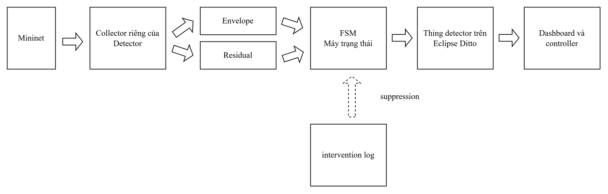

# 5.3 Phát hiện bất thường

Mọi kết quả ở mục này là của một mô hình detector duy nhất (phiên bản 2.1.0), học trên tám run
huấn luyện và cố định trước khi thu tập kiểm tra độc lập (Mục 3.4 và 4.3 của báo cáo).

Detector lấy số liệu thẳng từ Mininet qua collector riêng, chấm bằng hai kênh envelope và
residual, rồi đưa qua máy trạng thái (FSM) trước khi ghi kết luận lên Thing detector trên Ditto.
Nhật ký can thiệp của controller vòng kín dùng để bỏ qua các báo động do chính can thiệp gây ra.



Thứ tự đọc: `du-lieu/` (dữ liệu thô, xem mục cuối) → `mo-hinh/` (mô hình học được gì) → `tieu-chi-ghi-truoc/` (đạt là thế nào, ghi trước
khi đo) → `tap-phat-trien/` (Bảng 5.2, 5.3) → `tap-kiem-tra-doc-lap/` (Bảng 5.4, 5.5). Phân tích
sự cố trên link chỉ có TCP (Mục 5.3.3) nằm ở thư mục riêng
[5.3.3-su-co-link-chi-co-tcp](../5.3.3-su-co-link-chi-co-tcp/).

Các tệp JSON ở đây phần lớn có dạng `{"content": {...}, "content_sha256": "..."}`. Dữ liệu nằm
trong `content`, còn `content_sha256` là mã băm của chính phần đó, dùng để kiểm tệp không bị sửa.

## `mo-hinh/`: mô hình

| Tệp | Nội dung | Tệp gốc |
|---|---|---|
| `envelope-2.1.0.json` | biên min/max của 71 cột (`content.bounds`), ngưỡng K = 18, E ≈ 5,609 (`content.thresholds.primary`) | `models/envelope-2.1.0.json` |
| `detector-release-2.1.0.json` | bản phát hành detector: envelope, residual, FSM (`content.fsm_params`), bộ chặn vùng tải | `models/detector-release-2.1.0.json` |
| `bang-bao-toan-residual.json` | bảng bảo toàn lưu lượng dùng cho kênh residual, ngưỡng R ≈ 0,0753 (`content.calibration.R`) | `results/report/gd4_conservation.json` |
| `bien-ban-hoc-lai.json` | biên bản học: tám run dùng để học (`content.train_run_ids`), K, E, R, ngưỡng vùng vận hành | `results/report/gd4_retrain.json` |
| `ma-bam-du-lieu-huan-luyen.json` | mã băm của dữ liệu huấn luyện và commit đã thu | `results/report/gd4_manifest.json` |

## `tieu-chi-ghi-truoc/`: chỉ tiêu ghi trước khi thu tập kiểm tra độc lập

| Tệp | Nội dung | Tệp gốc |
|---|---|---|
| `muc-dat-truoc.json` | chỉ tiêu S1, S2, S4, mức đặt trước, cách chấm, cam kết báo kết quả dù tốt hay xấu | `results/report/gd4_acceptance_prereg.json` |
| `muc-dat-truoc.md` | cùng nội dung, viết thành văn | `results/gd4/prereg.md` |

## `tap-phat-trien/`: Bảng 5.2 và 5.3

| Tệp | Nội dung | Tệp gốc |
|---|---|---|
| `excess-dual-va-iforest.json` | so sánh hai luật excess, dual và Isolation Forest trên phần kiểm tra của tập phát triển | `results/report/gd4_devset.json` |
| `thiet-ke-18-run.json` | thiết kế 18 run của tập phát triển: nhóm, mức tải, loại và vị trí sự cố, tham số sự cố (Bảng 4.2, 4.3) | `results/report/experiment_matrix.json` |
| `kiem-tra-tai-may-khach.json` | phép kiểm lưu lượng thực tế của từng máy khách trên 18 run: 17 run đạt, `N-vary-s1008-r2` không đạt nên bị loại khỏi dữ liệu huấn luyện (Mục 4.3) | `results/report/gd2_client_traffic_audit.json` |

Đọc tệp (bản 2.1 nằm ở các khóa `v21`, khóa `v1` là bản 1.0.0 cũ để đối chiếu):

| Trường | Giá trị |
|---|---|
| `content.envelope.v21.secondary_excess.tp` / `n_positive` | 137/160 giây có sự cố được phát hiện |
| `content.envelope.v21.secondary_excess.fp` / `n_negative` | 23/430 giây bình thường bị báo nhầm |
| `content.envelope.v21.secondary_excess.recall_by_fault` | tỉ lệ phát hiện theo loại sự cố |
| `content.envelope.v21.secondary_excess.positions` | báo nhầm nằm ở đâu: 0 ở run bình thường, 0 trước giây 21, dồn ở giây 41-47 |
| `content.envelope.v21.secondary_dual` | như trên cho luật dual: 127/160 và 5/430 |
| `content.iforest.v21.recall_mean`, `fpr_mean` | Isolation Forest: 0 trên cả 5 lần học, báo nhầm trung bình 0,0056 |

## `tap-kiem-tra-doc-lap/`: Bảng 5.4, 5.5 và các đoạn sau bảng

| Tệp | Nội dung | Tệp gốc |
|---|---|---|
| `cau-hinh-25-run.json` | cấu hình từng run (`runs[]`), nhóm run (`groups`): RD giảm băng thông, RC flood và dịch nút cổ chai, RN tải cao, RS chạy nền | `results/report/gd4r_contract.json` |
| `ma-bam-du-lieu-kiem-tra.json` | mã băm dữ liệu từng run, số run đã thu (24/25) | `results/report/gd4r_manifest.json` |
| `cham-giam-bang-thong-flood-tai-cao.json` | chấm nhóm RD, RC, RN. Riêng run `RN-load8M-s5014-r2` lấy ở tệp kế tiếp | `results/report/gd4_acceptance_v21.json` |
| `cham-lai-mot-run-tai-cao.json` | chấm lại run tải cao `RN-load8M-s5014-r2` sau khi thu lại | `results/report/gd4_acceptance_v21_rn_retry.json` |
| `cham-chay-nen-2-gio.json` | 2 run chạy nền 60 phút | `results/report/gd4_acceptance_v21_rs.json` |

Đọc tệp chấm (cả ba tệp `cham-*` cùng cấu trúc, kết luận nằm ở `content.verdicts`):

| Trường | Chỉ tiêu | Giá trị |
|---|---|---|
| `verdicts.S1.value` | tỉ lệ sự cố giảm băng thông được phát hiện, mức đặt trước ≥ 0,875 | 0,40, `FAIL` |
| `verdicts.S1.by_rho` | tách theo mức giảm ρ | |
| `verdicts.S4.value_ms` | thời gian phát hiện lớn nhất, mức đặt trước ≤ 3000 ms | 20 000 ms, `FAIL` |
| `verdicts.S4.all_values` | thời gian phát hiện từng sự cố | |
| `verdicts.RC_descriptive` | 4 run flood và dịch nút cổ chai | 4/4 phát hiện |
| `verdicts.S10` | báo động ở run tải cao, trước khi áp bộ chặn vùng tải | |
| `verdicts.operational_guard.per_run.<run>.combined.published_alarm_ticks` | số giây còn báo động sau khi áp bộ chặn vùng tải; báo cáo xét 6 run `RN-*` | 0 ở cả 6 run (run `RN-load8M-s5014-r2` lấy ở `cham-lai-mot-run-tai-cao.json`) |
| `verdicts.S2.value` (chỉ ở `cham-chay-nen-2-gio.json`) | cận trên 95% số báo động sai mỗi giờ, mức đặt trước ≤ 3 | 1,50 lần/giờ trên 2,0 giờ, `PASS` |

Trong `cham-giam-bang-thong-flood-tai-cao.json`, S2 ghi `PENDING` vì lượt chấm đó chưa có nhóm chạy nền.

## Chạy lại

| Script | Làm gì | Cần |
|---|---|---|
| `kiem_tra_offline.sh` | tính lại mọi con số của Mục 3.4 và 5.3 từ dữ liệu thô, in KHỚP hoặc LỆCH; không ghi tệp | offline, khoảng 1 phút |
| `cham_lai_tap_kiem_tra_doc_lap.sh` | chấm lại detector 2.1 trên tập kiểm tra độc lập, ghi `cham-RD-RC-RN.json` và `cham-RS.json` | offline, vài giây |

```bash
ket-qua-bao-cao/5.3-phat-hien-bat-thuong/kiem_tra_offline.sh
```

Mỗi script chạy được từ bất kỳ thư mục nào. Kết quả mới ghi vào `chay-lai/<thời điểm>/` ngay trong thư mục này, cùng tên với tệp đã lưu ở trên, nên mở hai tệp cạnh nhau là so được. Kết quả đã lưu không bị đè, kể cả khi script lỗi hay bị Ctrl-C.

Hai tệp do `cham_lai_tap_kiem_tra_doc_lap.sh` ghi có cùng cấu trúc với các tệp `cham-*.json` ở trên.
Dữ liệu của run `RN-load8M-s5014-r2` hiện là bản thu lại, nên `cham-RD-RC-RN.json` ứng với
`cham-giam-bang-thong-flood-tai-cao.json` và `cham-lai-mot-run-tai-cao.json` gộp lại.

`scripts/gd4_devset.py` (tập phát triển) và `python -m ml.gd4_retrain build` (học mô hình) ghi
vào `results/report/` và `models/`, nên từ chối chạy khi tệp đã có. `kiem_tra_offline.sh` chạy lại
đúng code của chúng mà không ghi gì.

### Thu lại dữ liệu (cần testbed, không có script riêng)

```bash
sudo mn -c
export DT4N_RYU=$(which ryu-manager)     # nếu Ryu không ở đường dẫn mặc định
PYTHONPATH="$PWD" .venv/bin/python scripts/launch_ml_dataset.py --campaign gd4r --only RD-degrade-s1-s2-rho200-s5101-r1   # một run
PYTHONPATH="$PWD" .venv/bin/python scripts/launch_ml_dataset.py --campaign gd4r                 # cả tập
```

`--campaign gd4` thu run huấn luyện, `--campaign gd4r` thu tập kiểm tra độc lập. Tên run lấy trong
`tap-kiem-tra-doc-lap/cau-hinh-25-run.json` (khóa `runs[].run_id`). Dữ liệu ghi vào `data/phase5/gd4r/`.
Hai cấu hình thu này ghi tên máy `dt4n-research-01`, từ chối chạy trên máy khác và bỏ qua run đã
có dữ liệu; xem lưu ý ở [README của thư mục](../README.md#hai-lưu-ý-khi-chạy-lại). Launcher cần
`sudo -n` chạy được không hỏi mật khẩu, vì runner Mininet chạy dưới quyền root.

## `du-lieu/`: dữ liệu thô

| Thư mục | Nội dung | Số run | Tệp gốc |
|---|---|---|---|
| `du-lieu/huan-luyen/` | tám run bình thường dùng để học detector 2.1: bảy run N của tập phát triển và run thu lại `N-vary-s1008-r4`. Run `N-vary-s1008-r2` bị loại vì máy khách không gửi đủ tải (`tap-phat-trien/kiem-tra-tai-may-khach.json`) | 8 | `data/phase5/raw/`, `data/phase5/gd4/raw/` |
| `du-lieu/tap-phat-trien/` | phần kiểm tra của tập phát triển: 2 run C bình thường và 8 run F có sự cố (4 loại × 2 vị trí). Mục 5.4 cũng dùng mười run này | 10 | `data/phase5/raw/` |
| `du-lieu/tap-kiem-tra-doc-lap/` | mọi run của tập kiểm tra độc lập, thu sau khi mô hình đã cố định: RD giảm băng thông, RC flood và dịch nút cổ chai, RN tải cao, RS chạy nền | 24 | `data/phase5/gd4r/raw/` |

Run thu lần đầu bị loại (`data/phase5/gd4r/quarantine/`) không chép vào đây.

### `du-lieu/csv/`: cùng dữ liệu dưới dạng bảng

Muốn mở bằng Excel hay pandas mà không đọc JSON, dùng các tệp CSV. Mỗi dòng là một giây của một
run, gồm cột thông tin (`run_id`, `nhom`, `tick`, `nhan`, ...), đúng 71 cột mà detector dùng và
cột `residual.r_max`. Ô trống là không đo được, không phải 0. Ý nghĩa và đơn vị từng cột ở
[`du-lieu/csv/mo-ta-cot.md`](du-lieu/csv/mo-ta-cot.md).

| Tệp | Số dòng | Số run |
|---|---|---|
| `huan-luyen.csv` | 480 (472 giây sau khi bỏ giây khởi động) | 8 |
| `tap-phat-trien.csv` | 600 (160 giây có nhãn sự cố) | 10 |
| `tap-kiem-tra-doc-lap.csv` | 8 516 | 24 |

Các tệp sinh bằng `scripts/xuat_csv_du_lieu.py`, dùng chính code tính chỉ số của detector.
`--check` tính lại và so với tệp đã lưu, đồng thời kiểm min, max của từng cột trên `huan-luyen.csv`
bằng đúng biên trong `mo-hinh/envelope-2.1.0.json` (71/71 cột khớp).

### Mỗi run có hai tệp

- `<run>.meta.json` là lý lịch của run: `constants` (dài 60 s, sự cố bật ở giây 20 và gỡ ở giây 40,
  đo mỗi 1 s), `traffic_plan` (mức tải hoặc lịch tải), `events` (lúc tạo và gỡ sự cố, tham số sự
  cố), `record` (nhóm, loại sự cố, vị trí), `label_convention` (giây t mang nhãn sự cố khi
  20 < t ≤ 40). Run RS chạy nền dài 60 phút.
- `<run>.jsonl` có một dòng cho mỗi giây. Mỗi dòng là ảnh chụp toàn mạng tại giây đó:
  `tick`, `t_source` và `things` gồm 16 thiết bị (5 host, 3 switch, 8 link).

Tên run: `N-load2M-s1003-r1` là nhóm N (bình thường, để học), tải 2 Mbps mỗi máy khách, seed
1003, lần 1. `vary` là tải đổi theo lịch. Nhóm C là bình thường để kiểm, F là có sự cố. Ở tập
kiểm tra độc lập, tên run bắt đầu bằng RD, RC, RN, RS như ở trên.

### Đọc một thiết bị trong một giây

```json
"host-h1": {"traffic": {"txRate": 270926.28, "rxRate": 6066.36, "rateValid": true},
            "status": {"state": "up"}}
"link-s1-s2": {"capacity": {"bwMbps": 20.0},
               "traffic": {"txRate": 538689.93, "lossPct": 0.0, "qdiscDropDelta": 0,
                           "qdiscSentDelta": 548, "qdiscValid": true},
               "status": {"state": "up"}}
```

- `txRate`, `rxRate`: tốc độ gửi, nhận, đơn vị byte/s. Đổi sang Mbps: nhân 8, chia 10^6
  (270926 byte/s ≈ 2,17 Mbps).
- `rateValid`, `qdiscValid`: số đo dùng được hay không. Sai ở giây đầu và khi bộ đếm vừa bị đặt lại.
- `qdiscDropDelta`, `qdiscSentDelta`: số gói bị bỏ và đã gửi qua hàng đợi của link trong giây đó,
  cộng cả hai chiều. `lossPct` = bị bỏ / (bị bỏ + đã gửi) × 100.

### Từ ảnh chụp tới 71 cột của detector

`ml/flatten.py` làm phẳng mỗi giây thành một dòng, tên cột dạng `<thiết bị>.<nhóm>.<thuộc tính>`,
ví dụ `host-h1.traffic.txRate`, và đổi trạng thái thành cột `...state_up` (1 là up, 0 là down).
`ml/features.py` thêm các cột tổng hợp. Detector dùng 71 cột:

| Nhóm | Số cột | Gồm |
|---|---|---|
| tốc độ | 36 | rx/txRate của 5 host (10) và 8 link (16), `qdiscSentDelta` của 8 link, `agg.rate_absz_max`, `agg.rate_absz_n_above_3` |
| chỉ báo | 35 | `state_up` của 5 host, 3 switch, 8 link (16), `lossPct` (8), `qdiscDropDelta` (8), `agg.loss_max`, `agg.loss_n_above_alert`, `agg.links_down` |

Biên học được của từng cột nằm ở `mo-hinh/envelope-2.1.0.json`, khóa `content.bounds`. Ví dụ
`host-h1.traffic.txRate` có biên 131 081-672 022 byte/s (1,05-5,38 Mbps), còn mọi cột chỉ báo có
biên rộng 0 vì lúc bình thường không có gói nào bị bỏ và không thiết bị nào tắt.

### Tự mở một run

```bash
PYTHONPATH="$PWD" .venv/bin/python
```
```python
from ml.flatten import load_jsonl
df = load_jsonl('ket-qua-bao-cao/5.3-phat-hien-bat-thuong/du-lieu/tap-phat-trien/F-flood-h1_to_srv1-s3005-r1.jsonl')
x = df[['tick', 'host-h1.traffic.txRate', 'host-h3.traffic.txRate']].copy()
x.iloc[:, 1:] = x.iloc[:, 1:] * 8 / 1e6        # Mbps
print(x.iloc[[10, 22, 30, 42, 50]])            # h1 lên 20 Mbps khi flood, h3 tụt gần 0
```
