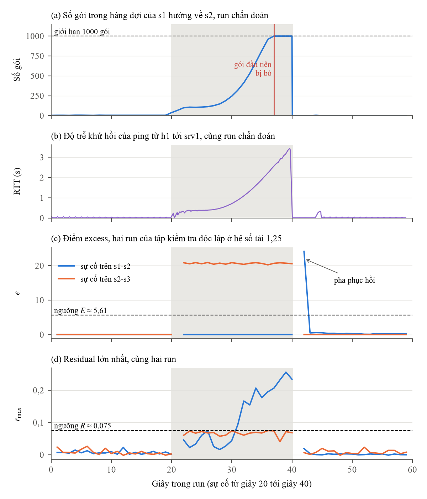

# 5.3.3 Sự cố trên link chỉ có lưu lượng TCP

Qua s1-s2 chỉ có luồng TCP của h1 và h3 tới srv1. Khi băng thông giảm, phần lưu lượng chưa qua
được có thể tích lại trong hàng đợi trước khi có gói bị bỏ, nên các cột chỉ báo của detector chưa
vượt biên. Đây là cách giải thích mà báo cáo dùng cho việc kênh envelope gần như bỏ sót sự cố
giảm băng thông trên s1-s2. Hai nguồn số liệu:

## Tệp kết quả

| Tệp | Nội dung | Tệp gốc |
|---|---|---|
| `excess-5-run-s1-s2.json` | 5 run giảm băng thông s1-s2 của tập kiểm tra độc lập, giây 21-39: không cột chỉ báo nào vượt biên; excess lớn nhất 0; 0; 0; 1,00; 0,28 (ρ từ 0,5 tới 2,0) so với E ≈ 5,6; h3 dưới biên dưới 12/20 giây ở ρ = 2,0; độ rộng vùng tốc độ máy khách 4,3-5,4 Mbps | `results/report/gd4_s1s2_excess.json` |
| `hang-doi-offload-bat-lan-1.json`, `hang-doi-offload-bat-lan-2.json` | phép thử hàng đợi với offload bật, sự cố 20 s, hai lần lặp: 0 gói bị bỏ trong 20 s, RTT từ 12,1 lên 2694 ms, phần byte thiếu nằm trong hàng đợi | `results/probe/degrade_sensor_s1-s2_f0.8275_20260917T045444Z.analysis.json`, `..._20260917T045726Z.analysis.json` |
| `hang-doi-3-dieu-kien.json` | phép thử hàng đợi với ba điều kiện, 6 run: khi tắt offload, gói đầu tiên bị bỏ ở giây 17 của sự cố; khi giữ offload và kéo dài sự cố lên 40 s, ở giây 25; cả hai lúc hàng đợi gần đầy 1000 gói. Đối chứng trên s2-s3 (chỉ có UDP) bỏ gói từ giây 11 | `results/probe/v2_report.json` |

## Đọc tệp

| Tệp | Trường | Ý nghĩa |
|---|---|---|
| `excess-5-run-s1-s2.json` | `content.runs.<run>.v21.excess_max_21_39` | excess lớn nhất trong lúc có sự cố, so với ngưỡng `threshold_E` |
| | `content.runs.<run>.v21.below_lower_bound_ticks_21_40` | số giây tốc độ từng máy khách dưới biên dưới |
| | `content.client_rate_width_mbps.v21` | độ rộng vùng tốc độ bình thường của h1, h2, h3 |
| `hang-doi-offload-bat-lan-*.json` | `summary.missing_bytes` | số byte đi vào link mà không ra khỏi link trong 20 s sự cố, đã trừ độ lệch nền đo trước sự cố |
| | `summary.leaf_drop_packets`, `other_drop_packets`, `ovs_tx_drop_packets` | gói bị bỏ ở từng chỗ (0, 0, 0) |
| | `summary.backlog_bytes_pre_revert` | byte còn nằm trong hàng đợi ngay trước khi gỡ sự cố |
| | `per_tick[]` | số đo từng giây |
| `hang-doi-3-dieu-kien.json` | `runs[].condition` | `C2_offload_off_s1-s2` tắt offload, `C1_long_fault_s1-s2` sự cố 40 s, `C0_control_s2-s3` đối chứng |
| | `runs[].summary.first_leaf_drop_tick`, `qlen_at_first_drop` | giây có gói bị bỏ đầu tiên, độ dài hàng đợi lúc đó |
| | `verdict.conclusions` | kết luận theo luật đã ghi trước |

Dữ liệu thô của phép thử hàng đợi (`.jsonl`, `.meta.json`, `.ping.log`) và tệp phân tích từng lần
(`.analysis.json`, `.analysis_v2.json`) nằm trong `du-lieu-tho/`, chép nguyên tên từ `results/probe/`.
Tên tệp ghi link, hệ số giảm băng thông (`f0.8275`), chế độ offload (`offon`, `offoff`), giây gỡ sự cố
(`rev40`, `rev60`) và thời điểm đo.

## Hình



`hinh/dien-bien-s1-s2` (Hình 5.2 của báo cáo) cho thấy cơ chế của mục này theo từng giây, vùng tô
xám là lúc sự cố đang diễn ra (giây 20-40).

- (a) Run chẩn đoán `du-lieu-tho/degrade_sensor_s1-s2_f0.8275_offoff_rev40_20260917T074237Z`: số gói
  trong hàng đợi của s1 hướng về s2 dâng dần và chạm giới hạn 1000 gói, gói đầu tiên bị bỏ ở giây 37.
- (b) Cùng run đó: độ trễ khứ hồi của ping từ h1 tới srv1 tăng từ khoảng 12 ms lên hơn 3 s.
- (c) Hai run ở hệ số tải 1,25 của tập kiểm tra độc lập: excess của sự cố trên s2-s3 vượt ngưỡng E
  ngay từ giây đầu, còn của sự cố trên s1-s2 nằm ở 0 suốt sự cố. Đỉnh ở giây 42 trên s1-s2 là pha
  phục hồi sau khi gỡ sự cố.
  Khác biệt giữa hai link chủ yếu đến từ độ rộng vùng bình thường: khi huấn luyện, s2-s3 chỉ chở
  luồng UDP nền cố định nên vùng bình thường của tốc độ qua link rất hẹp (2,15-2,17 Mbps), còn s1-s2
  chở luồng TCP của máy khách với tải thay đổi 1-5 Mbps nên vùng rộng (1,06-9,73 Mbps). Ở s2-s3, excess
  vượt ngưỡng ở giây 22, trước khi có gói nào bị bỏ.
- (d) Cùng hai run: residual của sự cố trên s1-s2 vượt ngưỡng R liên tục từ giây 31, tức 11 s sau
  sự cố, đúng thời gian phát hiện ghi trong báo cáo.

Giây ngay sau khi đổi băng thông (giây 21, 41) bị bỏ trống vì bộ đếm hàng đợi vừa bị đặt lại, dữ
liệu không hợp lệ và detector không dùng các giây này. Excess và residual được tính bằng chính code
của detector 2.1.

Vẽ lại bằng `ve_hinh.sh` (offline, vài giây). Script vẽ là `hinh/ve_hinh.py`.

## Chạy lại

| Script | Làm gì | Cần |
|---|---|---|
| `kiem_tra_offline.sh` | tính lại excess trên 5 run s1-s2, so khớp với `excess-5-run-s1-s2.json`; không ghi tệp | offline |
| `phan_tich_lai_hang_doi.sh` | phân tích lại phép thử hàng đợi từ dữ liệu thô đã lưu, ghi `hang-doi-*.json` | offline |
| `do_lai_thu_hang_doi.sh` | đo lại phép thử hàng đợi: bốn điều kiện, mỗi điều kiện hai lần, rồi phân tích | testbed, root |

```bash
ket-qua-bao-cao/5.3.3-su-co-link-chi-co-tcp/phan_tich_lai_hang_doi.sh
```

Mỗi script chạy được từ bất kỳ thư mục nào. Kết quả mới ghi vào `chay-lai/<thời điểm>/` ngay trong thư mục này, cùng tên với tệp đã lưu ở trên, nên mở hai tệp cạnh nhau là so được. Kết quả đã lưu không bị đè, kể cả khi script lỗi hay bị Ctrl-C.

Chạy bằng Python khác bản 3.13 đã dùng khi thu, `phan_tich_lai_hang_doi.sh` cho kết quả chỉ khác
bản đã lưu ở chữ số thập phân cuối và dòng ghi phiên bản Python.

`do_lai_thu_hang_doi.sh` đo bốn điều kiện: s1-s2 offload bật (như `hang-doi-offload-bat-lan-*`),
s1-s2 tắt offload (C2), s1-s2 sự cố kéo dài 40 s (C1), s2-s3 chỉ có UDP (C0). Dữ liệu thô từng
lần (`.jsonl`, `.meta.json`, `.ping.log`) nằm cùng thư mục kết quả mới. Script cần testbed hỏi mật khẩu sudo một lần ở đầu, tự kiểm môi trường (`scripts/kiem_tra_moi_truong.py --testbed`) và dọn Mininet trước khi chạy. Nếu `ryu-manager` không nằm trong PATH, đặt `export DT4N_RYU=/đường/dẫn/tới/ryu-manager` trước.

Dữ liệu thô của phép thử đã lưu ở `results/probe/`. Code: `scripts/probe_degrade_sensor.py` (đo),
`scripts/analyze_degrade_sensor_probe.py` và `_v2.py` (phân tích), `scripts/gd4_s1s2_excess.py` (excess).
