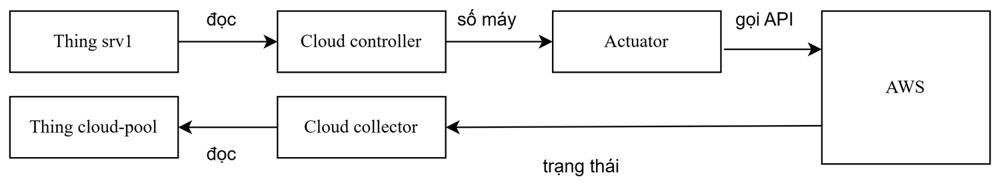

# 5.6 Tự động hóa tài nguyên đám mây

Cloud controller đọc tải và trạng thái của srv1 trên twin, tính số máy EC2 mong muốn và nhờ
actuator gọi API của AWS. Cloud collector đọc lại trạng thái Auto Scaling Group và ghi vào Thing
`cloud-pool`. Máy EC2 không mang lưu lượng của Mininet.



## Tệp kết quả

| Tệp | Dùng ở báo cáo | Tệp gốc |
|---|---|---|
| `tung-luot.jsonl` | mỗi dòng là một lượt: kịch bản, mốc thời gian từng chặng, số lệnh, số máy mong muốn, đạt hay không, lượt không hợp lệ | `results/cloud/gd1_trials.jsonl` |
| `tong-hop-theo-kich-ban.json` | tổng hợp theo kịch bản: 5/5 lượt đạt ở quá tải, mất kết nối, thay máy; đối chứng tải bình thường 0 lệnh; cân bằng tải 50/50 | `results/cloud/gd1_receipt.json` |
| `nhat-ky-cloud-controller.jsonl` | nhật ký từng quyết định của cloud controller: đầu vào, mức tải, mức dự phòng, số máy mong muốn, nối bằng mã băm. Bản ghi `seq` 92-97 là lượt 4 của kịch bản mất kết nối, khi ASG lên 2 máy trong pha phục hồi (Mục 5.6, 5.8) | `logs/cloud_controller_audit.jsonl` |
| `du-lieu-tho/samples_<kịch bản>_rep<lượt>_<mã>.jsonl` | mẫu twin và AWS ghi trong suốt từng lượt: hệ số tải, trạng thái srv1, số máy mong muốn, đang chạy, sẵn sàng (đạt kiểm tra tình trạng của Load Balancer) | `results/cloud/samples_*.jsonl` |

Bảng 5.7 (kết quả theo kịch bản) và Bảng 5.8 (thời gian từng chặng, trung vị [nhỏ nhất; lớn nhất])
tính từ `tung-luot.jsonl`.

## Đọc tệp

| Tệp | Trường | Ý nghĩa |
|---|---|---|
| `tung-luot.jsonl` | `scenario`, `rep`, `outcome` | kịch bản (`flood`, `linkdown`, `replace`, `quiet`, `lb`), lượt thứ mấy, `PASS`, `FAIL` hoặc `INVALID` |
| | `metrics.t_inject`, `t_onset`, `t_decision`, `t_applied`, `t_inservice`, `t_healthy` | mốc thời gian: gây sự cố, twin ghi nhận sự cố, controller quyết định, AWS nhận lệnh, máy mới vào dịch vụ, máy sẵn sàng |
| `tong-hop-theo-kich-ban.json` | `criteria` | điều kiện đạt của từng kịch bản |
| | `summary.<kịch bản>.n_pass` / `n_counted` | số lượt đạt trên số lượt được tính |
| | `summary.<kịch bản>.segments` | thời gian từng chặng của Bảng 5.8, ví dụ `onset_to_decision_s`, `decision_to_applied_s` (`median`, `min`, `max`) |

## Chạy lại (cần testbed và tài khoản AWS, có chi phí)

Mục này không có script chạy một lệnh: thí nghiệm cần bốn tiến trình chạy song song ở bốn terminal
(testbed, cloud collector, cloud controller, kịch bản), một số kịch bản phải tắt controller giữa
chừng, và mỗi lượt tạo máy EC2 thật có tính tiền. Làm theo từng bước dưới đây.

Cần quyền EC2, Auto Scaling, Elastic Load Balancing ở region `ap-southeast-1`, và `boto3`.
Thí nghiệm tạo máy t3.micro thật. Luôn chạy `cloud.infra down` khi xong.

```bash
export PYTHONPATH="$PWD"
python3 -m cloud.infra up                  # dựng ASG (0 máy) gắn với Load Balancer
python3 -m cloud.collector bootstrap       # tạo Thing cloud-pool, một lần
```

Mỗi lệnh sau chạy ở một terminal riêng, cùng với Ditto, Ryu và `mininet.run_sync` (xem
[README chính](../../README.md#chạy-hệ-thống-để-xem-demo)):

```bash
python3 -m cloud.collector run --period 5
python3 -m cloud.controller run            # thêm --dry-run để chỉ ghi quyết định, không gọi AWS
```

Các kịch bản (mỗi lệnh một lượt, lặp `--rep 1` tới `--rep 5`):

```bash
python3 -m cloud.experiment trial flood --rep 1           # quá tải, cần cloud.controller đang chạy
python3 -m cloud.experiment trial linkdown --rep 1        # mất kết nối srv1, cần cloud.controller
python3 -m cloud.experiment trial replace --rep 1 --prep  # thay máy, phải TẮT cloud.controller
python3 -m cloud.experiment quiet --minutes 10            # đối chứng tải bình thường, cần cloud.controller
python3 -m cloud.experiment lb --n 100                    # cân bằng tải, tắt controller, cần 2 máy sẵn sàng
python3 -m cloud.experiment report                        # ghi bảng và receipt
python3 -m cloud.infra down                               # dọn sạch tài nguyên AWS
```

Lượt chạy sai điều kiện ban đầu (ví dụ controller còn chạy ở kịch bản thay máy) được ghi
`INVALID` và không tính, như lượt không hợp lệ ở Bảng 5.7.
