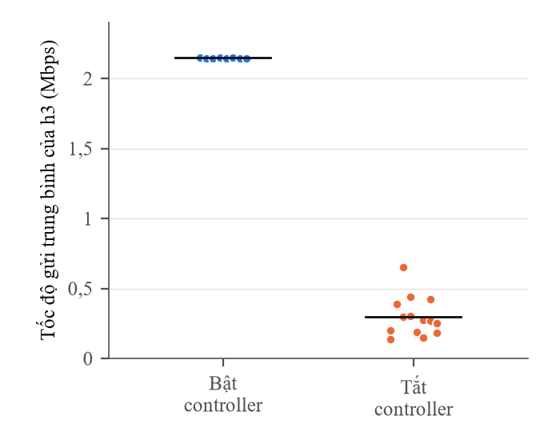
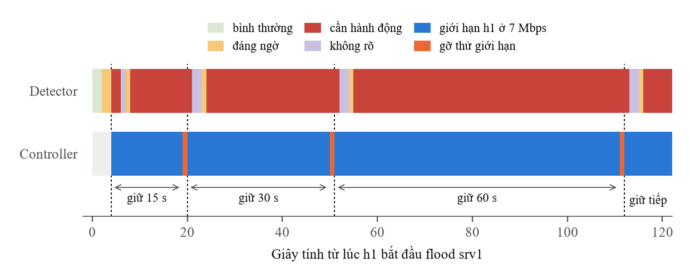

# 5.7 Vòng kín giảm thiểu trên testbed

Vòng kín: detector báo nghẽn, controller chọn một máy khách và giới hạn băng thông của máy đó
qua lệnh gửi tới twin, rồi gỡ thử giới hạn theo lịch. Controller chọn ứng viên theo chiều: chỉ
giữ máy khách có tốc độ gửi trên twin vượt biên trên của chính nó trong mô hình envelope
(`scripts/gd4cl_common.py`), và chỉ hành động khi còn đúng một ứng viên. Detector là bản 2.1.0
của Mục 5.3.

Hai phép đo:

- A/B bảo vệ: h1 flood UDP 47 Mbps tới srv1 trong 120 s; so tốc độ gửi trung bình của h3 khi
  bật và khi tắt controller; 8 khối, mỗi khối 4 lượt theo thứ tự ABBA hoặc BAAB; h2 là đối chứng.
- Phép thử định vị: 4 kịch bản (h3 flood srv1, h2 flood srv2, h1 flood srv2, dừng flood khi
  controller đang gỡ thử), 5 lượt mỗi kịch bản; mỗi lượt được xếp vào chọn đúng máy gây nghẽn, sai
  mục tiêu, hoặc không hành động. Trước mỗi lượt, tải nền được khởi động lại và lượt chỉ bắt
  đầu khi đủ ba luồng TCP và luồng UDP srv1 tới srv2.

## Tệp kết quả

| Tệp | Dùng ở báo cáo | Tệp gốc |
|---|---|---|
| `tieu-chi-ghi-truoc.json` | thiết kế, ngưỡng và cách chấm, ghi trước khi chạy | `results/report/gd4cl_prereg.json` |
| `kiem-offline-luat-chon.json` | luật chọn ứng viên chạy offline trên 30 run đã có | `results/report/gd4cl_offline_check.json` |
| `ab-bao-ve.json` | A/B 32 lượt: h3 gửi 2,146 Mbps khi bật controller, 0,295 Mbps khi tắt; bật cao hơn ở 8/8 khối, p = 0,008; h2 chênh -0,0003 Mbps; 0 lượt hủy; Hình 5.4 | `results/report/gd4cl_ab.json` |
| `thu-dinh-vi.json` | phép thử định vị: 20/20 lượt chọn đúng máy gây nghẽn (5/5 mỗi kịch bản), 0 sai mục tiêu, 0 lượt hủy, 10 lượt máy gây nghẽn khác h1; Bảng 5.9 | `results/report/gd4cl_c1.json` |
| `do-tre-quan-sat-cho-bang-3.8.json` | độ trễ từ lúc sự cố xảy ra tới lúc collector của detector ghi nhận nó, 25 lần h1 flood srv1 với detector 1.0.0. `content.layers.phys_obs.p95_ms` = 1432,6 ms là số 1,43 s trong thời gian cần để phát hiện lại ở Bảng 3.8 | `results/report/phase7_e2e_latency.json` |
| `du-lieu-tho/nhat-ky-controller-ab/ab_C_b*_i*.jsonl` | nhật ký controller của 16 lượt bật controller trong A/B, một dòng mỗi quyết định; Hình 5.5 | `logs/gd4cl_from_gcp/gd4cl_ab/20261016T103632Z/` |

## Đọc tệp

Cả bốn tệp có dạng `{"content": {...}, "content_sha256": "..."}`, dữ liệu nằm trong `content`.

| Tệp | Trường | Ý nghĩa |
|---|---|---|
| `tieu-chi-ghi-truoc.json` | `rule`, `code_sha256` | luật chọn ứng viên và mã băm code sẽ chạy, ghi trước thí nghiệm |
| `kiem-offline-luat-chon.json` | `runs.<run>` | với từng run đã có: số giây detector ở mức hành động (`act_ticks`), ứng viên theo luật cũ và luật theo chiều (`directional`) |
| `ab-bao-ve.json` | `primary.arm_means.C`, `.B` | tốc độ gửi trung bình của h3 khi bật (C) và tắt (B) controller, Mbps |
| | `primary.block_diffs`, `blocks_c_greater` | chênh lệch ở từng khối, số khối bật cao hơn tắt (8) |
| | `primary.randomization_test.p_two_sided` | p của kiểm định hoán vị (0,0078) |
| | `secondary`, `negative_control_h2_ci_contains_zero` | đối chứng h2 không bị ảnh hưởng |
| | `trials[]` | từng lượt, dùng để vẽ Hình 5.4 và lấy mốc bắt đầu flood cho Hình 5.5 |
| `thu-dinh-vi.json` | `by_scenario.<kịch bản>` | `correct_latch` chọn đúng máy gây nghẽn, `wrong_target` sai mục tiêu, `silent` không hành động |
| | `n_wrong_target`, `n_aborted`, `n_correct_nonh1_culprit` | 0, 0, 10 |
| | `trials[]` | từng lượt |

## Hình



`hinh/ab-tung-luot` (Hình 5.4 của báo cáo): tốc độ gửi trung bình của h3 ở 32 lượt A/B. Mỗi chấm là
một lượt, vạch ngang là trung bình của phương án.



`hinh/dien-bien-vong-kin` (Hình 5.5 của báo cáo): diễn biến lượt bật controller ở khối 0, lượt 1,
tính từ lúc h1 bắt đầu flood srv1. Dải trên là trạng thái detector công bố trên twin ở từng giây,
dải dưới là việc controller đang làm, vạch đứt là lúc controller đặt giới hạn 7 Mbps cho h1.
Controller giữ giới hạn 15 s rồi gỡ thử. Vì h1 vẫn đang flood, detector vẫn xác định h1 là máy gây nghẽn ngay giây sau, nên
controller đặt lại giới hạn ngay giây sau và giữ gấp đôi (30 s, rồi 60 s).

Hình vẽ từ `du-lieu-tho/nhat-ky-controller-ab/`, nhật ký controller của 16 lượt bật controller, mỗi
dòng là một quyết định kèm trạng thái detector mà controller đọc trên twin. Khi vẽ, script cũng in
thống kê trên cả 16 lượt: 48 lần gỡ thử, cả 48 lần đều được đặt lại ngay ở giây kế tiếp, và trong
lúc giữ, detector báo cần hành động ở 1623/1878 giây. Ở mọi giây đó, danh sách vượt biên đều có link
s2-s3, nằm ngoài vùng ảnh hưởng của can thiệp trên link h1-s1, nên báo động không bị ức chế.

Vẽ lại bằng `ve_hinh.sh` (offline, vài giây). Script vẽ là `hinh/ve_hinh.py`.

## Chạy lại

| Script | Làm gì | Cần |
|---|---|---|
| `kiem_tra_offline.sh` | so khớp kiểm offline luật chọn ứng viên với kết quả đã lưu, chạy bộ test của luật; không ghi tệp | offline |
| `do_lai_tren_testbed.sh` | A/B bảo vệ (khoảng 1 giờ 30 phút) rồi phép thử định vị (khoảng 40 phút), ghi `ab-bao-ve.json`, `thu-dinh-vi.json` | testbed |
| `do_lai_tren_testbed.sh ab` | chỉ A/B bảo vệ | testbed |
| `do_lai_tren_testbed.sh c1` | chỉ phép thử định vị | testbed |

```bash
ket-qua-bao-cao/5.7-vong-kin/kiem_tra_offline.sh
ket-qua-bao-cao/5.7-vong-kin/do_lai_tren_testbed.sh ab
```

Mỗi script chạy được từ bất kỳ thư mục nào. Kết quả mới ghi vào `chay-lai/<thời điểm>/` ngay trong thư mục này, cùng tên với tệp đã lưu ở trên, nên mở hai tệp cạnh nhau là so được. Kết quả đã lưu không bị đè, kể cả khi script lỗi hay bị Ctrl-C.

Script cần testbed hỏi mật khẩu sudo một lần ở đầu, tự kiểm môi trường (`scripts/kiem_tra_moi_truong.py --testbed`) và dọn Mininet trước khi chạy. Nếu `ryu-manager` không nằm trong PATH, đặt `export DT4N_RYU=/đường/dẫn/tới/ryu-manager` trước. Cần thêm Ditto với MongoDB trần ít nhất 1 GiB (`ditto/docker-compose.yml` đã đặt sẵn), và
không có Mininet hay Ryu nào khác đang chạy. Script bật Ryu riêng từ gốc repo cho từng runner rồi
tắt khi xong; nhật ký của Ryu và từng runner nằm cùng thư mục kết quả mới.

Bên trong, script gọi `scripts/chay_vong_kin.sh`, script này gọi `scripts/run_gd4cl_ab.py` và
`scripts/run_gd4cl_dinh_vi.py`. Hai runner đó ghi `results/report/gd4cl_ab.json`, `gd4cl_c1.json`
và từ chối chạy nếu tệp đã có, nên đừng gọi trực tiếp.
